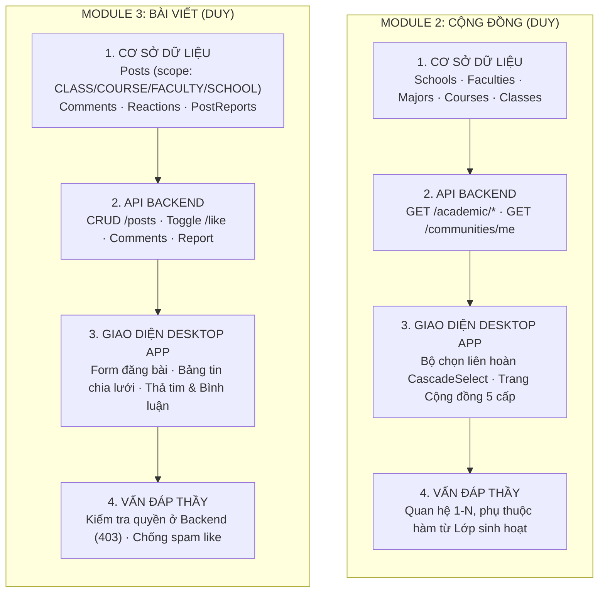

# UniConnect — Phân Hệ Cộng Đồng & Bài Viết (Module 2 & 3)

> **Môn học:** Lập trình mạng (Network Programming)  
> **Sinh viên phụ trách:** **Nguyễn Duy**  
> **Nhánh phát triển:** `feature/community`  
> **Phạm vi sở hữu:** **Module 2: Cộng đồng** & **Module 3: Bài viết** (Full-stack từ CSDL → API → Desktop App → Demo & Vấn đáp)

---

## 1. Tổng quan nhiệm vụ của Duy

Theo quy chế phân công trọn gói theo chiều dọc (Vertical Slice Full-stack), thành viên **Nguyễn Duy** sở hữu và chịu trách nhiệm độc lập từ đầu đến cuối về 2 module cốt lõi của mạng xã hội sinh viên:



---

## 2. Chi tiết Module 2: Cộng Đồng (Community)

### 2.1. Nghiệp vụ & Dữ liệu mẫu (Giai đoạn 1)
- **Cấu trúc phân cấp đào tạo:** Xây dựng mô hình cây quan hệ: `Trường (DAU) → Khoa (CNTT, Kiến trúc) → Ngành (CNTT, KTPM, Kiến trúc CT) → Khóa (K22, K23) → Lớp (23CT1, 23CT2, 23KT1)`.
- **Dữ liệu mẫu (`seed.ts`):** Tạo sẵn cơ sở dữ liệu thực tế tại ĐH Kiến trúc Đà Nẵng cùng tài khoản sinh viên mẫu đại diện cho các lớp khác nhau để phục vụ toàn nhóm kiểm thử.
- **Nguyên lý phân luồng:** Sinh viên chỉ cần chọn Lớp (`class_id`), hệ thống tự động suy ra toàn bộ cây phân cấp học tập tương ứng (tính chất bắc cầu trong chuẩn hoá CSDL).

### 2.2. Danh sách Endpoint API
| Phương thức | Đường dẫn Endpoint | Mô tả chức năng | Xác thực |
|---|---|---|:---:|
| `GET` | `/api/academic/schools` | Lấy danh sách toàn bộ trường học | Không |
| `GET` | `/api/academic/faculties?schoolId=` | Lọc danh sách khoa trực thuộc trường | Không |
| `GET` | `/api/academic/majors?facultyId=` | Lọc danh sách ngành trực thuộc khoa | Không |
| `GET` | `/api/academic/courses?schoolId=` | Lọc danh sách khóa sinh viên theo trường | Không |
| `GET` | `/api/academic/classes?majorId=&courseId=` | Lọc lớp sinh hoạt theo ngành và khóa | Không |
| `GET` | `/api/communities/me` | Lấy cây 5 cấp đào tạo, sĩ số từng cấp và danh sách bạn cùng lớp của sinh viên đang đăng nhập | Bearer JWT |
| `GET` | `/api/communities/classes/:id/members` | Danh sách thành viên lớp học (hỗ trợ phân trang và tìm kiếm) | Bearer JWT |
| `GET` | `/api/communities/overview` | Tổng quan toàn bộ cây phân cấp đào tạo toàn trường | Không |

### 2.3. Màn hình Desktop App
- **Bộ chọn liên hoàn (`CascadeSelect.tsx`):** Dropdown phụ thuộc nhau theo chuỗi logic: Chọn Trường → mới mở ô Khoa → chọn Khoa mới mở ô Ngành → chọn Khóa → hiển thị danh sách Lớp.
- **Trang Cộng đồng (`CommunitiesPage.tsx`):** Hiển thị 5 thẻ ngang trực quan cho 5 cấp đào tạo kèm sĩ số thực tế, danh sách bạn cùng lớp có avatar, MSSV và ô tìm kiếm nhanh bạn học.

---

## 3. Chi tiết Module 3: Bài Viết & Tương Tác (Posts)

### 3.1. Nghiệp vụ & Cơ chế bảo mật
- **Phạm vi bài viết (`scope`):** Cho phép giới hạn đối tượng xem bài viết: `CLASS` (Chỉ lớp xem), `COURSE` (Cùng khóa), `MAJOR` (Cùng ngành), `FACULTY` (Cùng khoa), `SCHOOL` (Toàn trường), `PUBLIC` (Công khai).
- **Phân loại danh mục (`category`):** `STUDY` (Học tập), `COMMUNITY` (Cộng đồng), `ACTIVITY` (Hoạt động), `OPPORTUNITY` (Cơ hội).
- **Bảo mật quyền sở hữu (Strict Backend Auth):**
  - Chỉ chính tác giả bài viết mới có quyền sửa bài (`PUT /posts/:id`).
  - Chỉ tác giả bài viết hoặc người dùng có quyền `ADMIN` mới được xóa bài (`DELETE /posts/:id`).
  - Nếu người dùng khác cố tình gọi API xóa bài bằng Postman, server lập tức trả về mã lỗi **`403 Forbidden`**.
- **Cơ chế Toggle Like chống trùng lặp:**
  - Tầng CSDL: Ràng buộc duy nhất `@@unique([postId, userId])` trong bảng `reactions`.
  - Tầng Backend: Xử lý dạng Toggle — nếu chưa like thì thêm và `likesCount + 1`, nếu đã like thì hủy và `likesCount - 1`.
- **Bình luận & Báo cáo vi phạm:** Bình luận hỗ trợ `parentId` đa tầng; Báo cáo vi phạm gửi trực tiếp sang bảng `post_reports` để Admin kiểm duyệt.

### 3.2. Danh sách Endpoint API
| Phương thức | Đường dẫn Endpoint | Mô tả chức năng | Xác thực |
|---|---|---|:---:|
| `POST` | `/api/posts` | Đăng bài viết mới kèm scope, category, ảnh | Bearer JWT |
| `GET` | `/api/posts` | Lấy danh sách bài viết (phân trang, lọc theo scope/category/search) | Tùy chọn |
| `GET` | `/api/posts/:id` | Xem chi tiết 1 bài viết kèm trạng thái `isLikedByMe` | Tùy chọn |
| `PUT` | `/api/posts/:id` | Chỉnh sửa bài viết (chỉ tác giả, người khác bị chặn 403) | Bearer JWT |
| `DELETE` | `/api/posts/:id` | Xóa bài viết (tác giả hoặc Admin, người khác bị chặn 403) | Bearer JWT |
| `POST` | `/api/posts/:id/like` | Thả tim / Hủy thích bài viết (Cơ chế Toggle Like) | Bearer JWT |
| `POST` | `/api/posts/:id/comments` | Gửi bình luận mới vào bài viết | Bearer JWT |
| `GET` | `/api/posts/:id/comments` | Lấy danh sách bình luận của bài viết | Không |
| `POST` | `/api/posts/:id/report` | Báo cáo bài viết vi phạm lên Admin Dashboard | Bearer JWT |

### 3.3. Màn hình Desktop App
- **Trang Bài viết (`PostsPage.tsx`):**
  - Form đăng bài nhanh tích hợp chọn phạm vi và danh mục.
  - Bộ lọc bài viết nhanh theo phạm vi (Tất cả / Trong Lớp / Trong Khoa / Toàn Trường).
  - Tương tác thả tim nảy animation (`active:scale-125`), đổi màu tim hồng phấn và cập nhật số like tức thì.
  - Khu vực bình luận trực tiếp bên dưới bài viết.
  - Hộp thoại xác nhận xóa bài viết chuyên nghiệp (`ConfirmModal.tsx`), không dùng `confirm()` thô sơ của trình duyệt.
  - Popup gửi báo cáo vi phạm kèm chọn lý do rõ ràng.

---

## 4. Hướng dẫn chạy thử nghiệm Desktop App

Ứng dụng của Duy là **phần mềm Desktop Native** chạy độc lập trên **macOS** và **Windows** thông qua **Electron**.

### Bước 1: Khởi động Backend API Server (Terminal 1)
```bash
cd backend
npm install
npm run dev
# Server lắng nghe tại: http://localhost:4000
# Tài liệu Swagger UI: http://localhost:4000/api-docs
```

### Bước 2: Khởi động Frontend Client (Terminal 2)
```bash
cd client-web
npm install
npm run dev
# Vite dev server lắng nghe tại: http://localhost:5174
```

### Bước 3: Khởi chạy Cửa sổ Desktop App Native (Terminal 3)
```bash
cd client-web
npm run electron
# Cửa sổ ứng dụng UniConnect Desktop App sẽ tự động bật lên trên màn hình!
```

---

## 5. Kết quả kiểm thử tự động (Unit & Integration Tests)

Toàn bộ chức năng của Duy được kiểm thử nghiêm ngặt bằng **Vitest**:
- `tests/integration/community.test.ts`: **5/5 tests PASS** (Cây phân cấp đào tạo, kiểm tra JWT, trả về bạn cùng lớp, thành viên khoa).
- `tests/integration/post.test.ts`: **7/7 tests PASS** (CRUD bài viết, kiểm tra bảo mật 403 Forbidden khi người khác xóa/sửa, cơ chế Toggle Like, bình luận, chặn tự báo cáo bài của mình).
- Tổng kiểm thử toàn hệ thống: **28/28 tests PASS 100%**.

```bash
cd backend
npm test
```

---

## 6. Bộ câu hỏi vấn đáp với Thầy giáo (Chuẩn bị sẵn cho Duy)

- ❓ **Thầy hỏi:** *"Sinh viên được tự động đưa vào các cộng đồng nào, dựa vào dữ liệu nào?"*
  - 🗣️ **Duy trả lời:** *"Dạ thưa thầy, sinh viên chỉ cần chọn Lớp (`class_id`). Từ Lớp, hệ thống tự động xác định được Ngành (`major_id`), Khóa (`course_id`), Khoa (`faculty_id`) và Trường (`school_id`). Khi sinh viên vào hệ thống, API `GET /api/communities/me` tự động phân luồng sinh viên vào 4 cấp cộng đồng: Cộng đồng Lớp, Cộng đồng Khóa, Cộng đồng Khoa và Cộng đồng Trường."*

- ❓ **Thầy hỏi:** *"Vì sao chọn Trường rồi mới hiện Khoa? API xử lý thế nào?"*
  - 🗣️ **Duy trả lời:** *"Dạ ở giao diện Desktop App, dropdown Khoa lắng nghe sự kiện thay đổi của Trường. Khi chọn trường, giao diện gọi API `GET /api/academic/faculties?schoolId=...`. Ở Backend, câu truy vấn Prisma thực hiện `WHERE schoolId = :id` để lọc chính xác các khoa trực thuộc trường đó."*

- ❓ **Thầy hỏi:** *"Nếu người khác cố tình dùng Postman gọi API DELETE `/api/posts/:id` để xóa bài của em thì sao?"*
  - 🗣️ **Duy trả lời:** *"Dạ ở Backend trong file `post.service.ts`, trước khi xóa, em luôn kiểm tra `post.authorId !== currentUserId` và vai trò không phải `ADMIN`. Nếu không phải chủ bài viết, server lập tức ném ra lỗi `403 Forbidden` từ chối thao tác. Hệ thống bảo mật tại tầng Backend chứ không phụ thuộc vào việc ẩn nút ở giao diện."*

- ❓ **Thầy hỏi:** *"Làm sao chống một người bấm like nhiều lần để gian lận số like?"*
  - 🗣️ **Duy trả lời:** *"Dạ em chặn ở cả 2 tầng: Tầng CSDL có chỉ mục duy nhất `@@unique([postId, userId])` trong bảng `reactions`. Tầng Backend xử lý dạng Toggle: nếu đã có bản ghi thì xóa và giảm `likesCount - 1`, nếu chưa có thì tạo mới và tăng `likesCount + 1`."*
