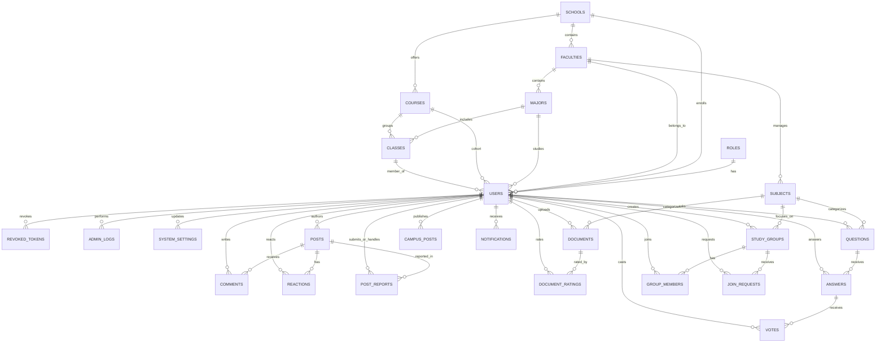

# Thiết Kế Cơ Sở Dữ Liệu Tổng Thể (ERD) — UniConnect

> **Người chủ trì thiết kế:** Nguyễn Ngô Tú Anh (Leader & Full-stack)
> **ORM & Schema nguồn:** [`backend/prisma/schema.prisma`](../backend/prisma/schema.prisma)

## 1. Sơ Đồ ERD (Mermaid)

## 2. Phân Công Sở Hữu Bảng Dữ Liệu

| Thành viên | Bảng phụ trách | Ghi chú thiết kế |
|---|---|---|
| **Nguyễn Ngô Tú Anh** | `roles`, `users`, `revoked_tokens`, `admin_logs`, `system_settings` | Quản lý xác thực JWT/Bcrypt, khóa tài khoản, lịch sử thao tác quản trị và cấu hình hệ thống |
| **Duy** | `schools`, `faculties`, `majors`, `courses`, `classes`, `posts`, `comments`, `reactions`, `post_reports` | Cấu trúc phân cấp trường học, bảng tin thông minh và báo cáo vi phạm |
| **Huy** | `subjects`, `documents`, `document_ratings`, `questions`, `answers`, `votes` | Kho tài liệu học tập (<=20MB) và hệ thống Q&A |
| **Bảo** | `study_groups`, `group_members`, `join_requests`, `campus_posts`, `notifications` | Nhóm học, tin Campus và thông báo Realtime Socket.io |

## 3. Chi Tiết Các Bảng Cốt Lõi (Core, Auth & Admin)

### 3.1. `roles`
| Cột | Kiểu | Ràng buộc | Mô tả |
|---|---|---|---|
| `id` | INT | PK, Auto Increment | ID vai trò |
| `name` | VARCHAR | UNIQUE, NOT NULL | `ADMIN`, `STUDENT` |
| `description` | VARCHAR | NULL | Mô tả quyền |
| `created_at` | DATETIME | DEFAULT NOW | Thời điểm tạo |

### 3.2. `users`
| Cột | Kiểu | Ràng buộc | Mô tả |
|---|---|---|---|
| `id` | INT | PK, Auto Increment | ID người dùng |
| `student_code` | VARCHAR | UNIQUE, NULL | Mã sinh viên (dùng đăng nhập hoặc định danh) |
| `email` | VARCHAR | UNIQUE, NOT NULL | Email sinh viên / quản trị |
| `password_hash` | VARCHAR | NOT NULL | Mật khẩu đã băm bằng Bcrypt |
| `full_name` | VARCHAR | NOT NULL | Họ và tên |
| `avatar_url` | VARCHAR | NULL | Ảnh đại diện |
| `bio` | TEXT | NULL | Giới thiệu bản thân |
| `phone` | VARCHAR | NULL | Số điện thoại |
| `role_id` | INT | FK -> `roles.id` | Vai trò người dùng |
| `school_id`, `faculty_id`, `major_id`, `course_id`, `class_id` | INT | FK (NULL) | Phân cấp cộng đồng học tập |
| `status` | VARCHAR | DEFAULT `'ACTIVE'` | `'ACTIVE'` hoặc `'LOCKED'` |
| `locked_reason` | VARCHAR | NULL | Lý do khóa tài khoản |
| `locked_at` | DATETIME | NULL | Thời điểm khóa |
| `failed_login_attempts` | INT | DEFAULT `0` | Số lần đăng nhập sai liên tiếp |
| `lock_until` | DATETIME | NULL | Thời điểm hết khóa tạm thời (brute-force protection) |
| `last_login_at` | DATETIME | NULL | Lần đăng nhập gần nhất |

### 3.3. `revoked_tokens`
- Lưu danh sách `jti` của JWT đã bị đăng xuất (`POST /api/auth/logout`) cho đến khi token hết hạn (`expires_at`), đảm bảo không thể tái sử dụng token sau logout.

### 3.4. `admin_logs`
- Ghi vết mọi hành động quản trị (`LOCK_USER`, `UNLOCK_USER`, `CHANGE_ROLE`, `RESOLVE_REPORT`, `HIDE_POST`, `DELETE_POST`, `CREATE_CAMPUS_POST`, `UPDATE_SETTING`, `MANAGE_ACADEMIC`).

### 3.5. `system_settings`
- Cấu hình động cho hệ thống dưới dạng key-value (`MAX_FILE_UPLOAD_MB`, `MAX_LOGIN_ATTEMPTS`, `LOGIN_LOCK_MINUTES`, `MAINTENANCE_MODE`, `SITE_NAME`...).
